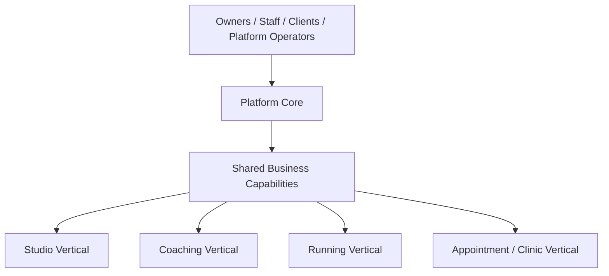
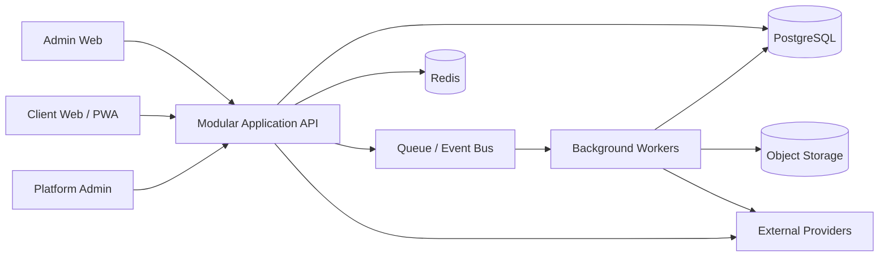

# Tempo Platform — Project Overview

> **Status:** Baseline architecture specification  
> **Audience:** Product, Architecture, Engineering, QA, Security, DevOps, Design, AI coding agents  
> **Scope rule:** The Platform Core remains industry-neutral. Studio-, coaching-, running-, clinic- and treatment-specific rules belong to vertical modules unless explicitly classified as shared business capabilities.  
> **Decision policy:** Statements marked **Decision** are normative. Statements marked **Open Decision** require an ADR before implementation.

## 1. Purpose

Tempo is a multi-tenant SaaS platform for fitness, coaching, wellness and related service businesses. It provides a reusable Platform Core and a set of vertical products. The Platform Core centralizes identity, organizations, tenancy, access control, people, subscriptions, entitlements, communications, files, integrations, audit, platform administration and shared operational infrastructure.

The system is not a single “generic studio application.” It is a product platform:

## 2. Product Thesis

Build one secure, commercially operable and extensible core, then deliver focused vertical products that reuse the core without forcing unrelated industries into a common business model.

## 3. Primary Business Problems

- Fragmented customer records across spreadsheets, messaging applications, calendars and payment systems.
- Repetitive administrative work.
- Inconsistent client communication.
- Weak visibility into business health and client lifecycle.
- Vendor lock-in and duplicate integrations.
- Security risk caused by ad-hoc identity and permission implementations.
- Difficulty launching new products because the same foundational capabilities must be rebuilt.

## 4. Target Actors

| Actor | Description |
|---|---|
| Platform Operator | Tempo internal support, operations, finance or security user. |
| Organization Owner | Legal or operational owner of a tenant. |
| Organization Administrator | Manages settings, staff, policies and selected billing operations. |
| Staff Member | Performs vertical-specific work within assigned scope. |
| Client / Member / Athlete / Patient | Receives services from an organization. |
| Guardian / Payer | Manages or pays for another person. |
| External System | Payment, messaging, calendar, wearable, accounting or identity provider. |

## 5. System Boundaries

### Platform Core owns

- Global identity and account lifecycle.
- Organizations and organization memberships.
- Tenant resolution and isolation.
- Permissions, roles, policies and scopes.
- People, contact points, relationships and consents.
- Platform subscription billing and entitlements.
- Communication delivery infrastructure.
- File and document infrastructure.
- Integration connection lifecycle.
- Audit and security records.
- Platform administration.
- Localization, branding primitives and environment-wide standards.

### Vertical products own

- Studio classes, sessions, capacity and waitlists.
- Coaching plans, assignments and professional progress workflows.
- Running workouts and performance analysis.
- Appointments, treatments and clinic workflows.
- Vertical-specific reports, terminology and client experiences.

## 6. Recommended Delivery Shape

**Decision:** Begin as a modular monolith with event-driven internal boundaries and separately deployable workers for asynchronous workloads.

## 7. Architecture Outcomes

The documentation set must enable implementation without rediscovering fundamental decisions. Each module must define:

1. Ownership and boundaries.
2. Entities, value objects and invariants.
3. State transitions.
4. Commands, queries and events.
5. API contracts.
6. Persistence rules.
7. Authorization policies.
8. Failure behavior.
9. Observability.
10. Tests and acceptance gates.

## 8. Definition of Ready for Development

Development may begin when:

- Foundational ADRs are approved.
- The organization, identity, tenancy and authorization models are stable.
- Module contracts and database ownership are documented.
- Initial API and event conventions are agreed.
- CI/CD and environment strategy are available.
- Security controls and test strategy are in place.
- The first vertical walking skeleton is selected.
