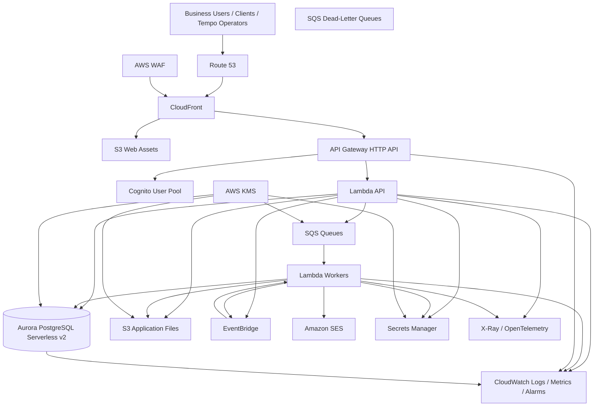
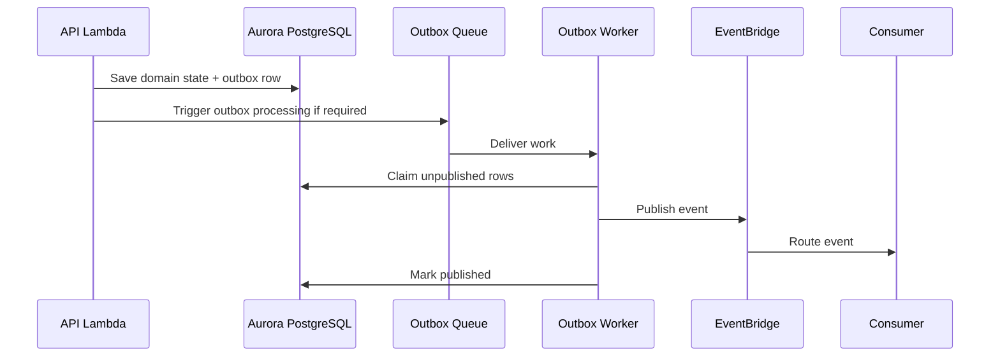

# Tempo AWS Infrastructure Low-Level Design (LLD)

> **Status:** Accepted implementation baseline  
> **Version:** 1.0  
> **Audience:** Architecture, Backend, Frontend, DevOps, Security, QA, Codex, Claude and other AI coding agents  
> **Cloud:** AWS only  
> **Primary Region:** `eu-central-1`  
> **Architecture Direction:** Serverless-first modular monolith  
> **Infrastructure as Code:** AWS CDK in TypeScript  
> **Related ADRs:** `ADR-0001` through `ADR-0015`, with special emphasis on AWS, Lambda, Aurora PostgreSQL Serverless v2, Cognito, API Gateway HTTP API, SQS, EventBridge, CloudWatch, CDK and environment isolation  

---

## 1. Purpose

This document defines the low-level AWS infrastructure design for Tempo.

It specifies:

- AWS account and environment structure.
- Naming and tagging.
- Network topology.
- Lambda runtime and deployment model.
- API Gateway configuration.
- Aurora PostgreSQL Serverless v2.
- SQS and EventBridge.
- Cognito.
- S3, CloudFront, Route 53, ACM and WAF.
- Secrets Manager, Parameter Store and KMS.
- CloudWatch, tracing and alarms.
- Backup, recovery and operational controls.
- AWS CDK stack structure.
- Deployment order.
- CI/CD integration.
- Security controls.
- Cost controls.
- Definition of done.

This document is mandatory for both human developers and AI coding agents.

When this document conflicts with an accepted ADR, the ADR takes precedence.

---

## 2. Architecture Summary



---

## 3. Environment Strategy

### 3.1 Mandatory Environments

Tempo must support:

```text
development
staging
production
```

Optional:

```text
preview
```

Preview environments are allowed only when cost controls and automated teardown exist.

### 3.2 AWS Account Strategy

Recommended structure:

```text
AWS Organization
├── Management / Billing Account
├── Shared Security / Logging Account
├── Development Account
├── Staging Account
└── Production Account
```

For the first implementation:

- Production must be isolated in a separate AWS account.
- Development and staging may temporarily share one non-production account.
- Production resources must never be created in the same account as developer experiments.
- Human access must use IAM Identity Center.
- Workloads must use IAM roles.
- GitHub Actions must assume environment-specific deployment roles through OIDC.

### 3.3 Region

Primary region:

```text
eu-central-1
```

Rules:

- All primary production workloads start in one region.
- Multi-AZ must be used where supported by managed services.
- Multi-region is not part of the initial architecture.
- Cross-region disaster recovery requires a separate ADR.
- Service availability in `eu-central-1` must be validated before adding any new AWS service.

---

## 4. Naming Convention

### 4.1 General Pattern

```text
tempo-{environment}-{component}-{purpose}
```

Examples:

```text
tempo-dev-api
tempo-dev-worker-notifications
tempo-dev-main-queue
tempo-dev-main-dlq
tempo-dev-files
tempo-prod-api
tempo-prod-aurora
```

### 4.2 Environment Codes

```text
dev
stg
prod
pr-{number}
```

### 4.3 Resource Name Rules

- Use lowercase where the service allows it.
- Use hyphens for human-readable names.
- Do not include secrets in names.
- Do not include email addresses.
- Names must be deterministic.
- Names must not depend on developer workstation state.
- Physical names should be explicitly set only when operationally required.
- CloudFormation logical IDs remain CDK-managed.

---

## 5. Mandatory Tags

Every supported AWS resource must include:

```text
Application=Tempo
Environment=dev|stg|prod
ManagedBy=AWS-CDK
Owner=Platform
CostCenter=Tempo
DataClassification=Public|Internal|Confidential|Restricted
Component=<component-name>
```

Optional:

```text
Vertical=<vertical-name>
Repository=tempo
CommitSha=<commit-sha>
```

Tag enforcement should be implemented through a common CDK tagging utility.

---

## 6. CDK Repository Structure

```text
infrastructure/
├── bin/
│   └── tempo.ts
│
├── lib/
│   ├── constructs/
│   │   ├── secure-bucket.ts
│   │   ├── secure-queue.ts
│   │   ├── lambda-defaults.ts
│   │   ├── log-group-defaults.ts
│   │   └── tagging.ts
│   │
│   ├── foundations/
│   │   ├── account-baseline-stack.ts
│   │   └── github-oidc-stack.ts
│   │
│   ├── networking/
│   │   └── network-stack.ts
│   │
│   ├── identity/
│   │   └── identity-stack.ts
│   │
│   ├── data/
│   │   ├── database-stack.ts
│   │   └── storage-stack.ts
│   │
│   ├── async/
│   │   ├── messaging-stack.ts
│   │   ├── events-stack.ts
│   │   └── scheduler-stack.ts
│   │
│   ├── api/
│   │   └── api-stack.ts
│   │
│   ├── frontend/
│   │   └── frontend-stack.ts
│   │
│   ├── observability/
│   │   └── observability-stack.ts
│   │
│   ├── security/
│   │   └── security-stack.ts
│   │
│   └── tempo-stage.ts
│
├── config/
│   ├── environment-config.ts
│   ├── development.ts
│   ├── staging.ts
│   └── production.ts
│
├── test/
│   ├── unit/
│   ├── assertions/
│   └── snapshots/
│
├── cdk.json
├── package.json
├── tsconfig.json
└── README.md
```

---

## 7. CDK Stack Boundaries

Initial stacks:

```text
AccountBaselineStack
GitHubOidcStack
NetworkStack
IdentityStack
DatabaseStack
StorageStack
MessagingStack
EventsStack
ApiStack
FrontendStack
ObservabilityStack
SecurityStack
```

### 7.1 Stack Rules

- Do not create one global stack containing everything.
- Do not create one stack per Lambda.
- Each stack must represent a stable lifecycle boundary.
- Avoid circular dependencies.
- Stack outputs should be minimal.
- Prefer passing construct references within a CDK Stage.
- Cross-account values must use controlled mechanisms.
- Secrets must never be exposed as plain outputs.
- Production stack deletion must be protected.
- Destructive resource replacement must require explicit review.

---

## 8. Environment Configuration Model

Each environment must use typed configuration.

Example:

```ts
export interface TempoEnvironmentConfig {
  readonly environmentName: "dev" | "stg" | "prod";
  readonly accountId: string;
  readonly region: string;

  readonly domainName: string;
  readonly apiDomainName: string;

  readonly enableDeletionProtection: boolean;
  readonly logRetentionDays: number;

  readonly aurora: {
    readonly minAcu: number;
    readonly maxAcu: number;
    readonly autoPause: boolean;
  };

  readonly lambda: {
    readonly apiMemoryMb: number;
    readonly apiTimeoutSeconds: number;
    readonly workerMemoryMb: number;
    readonly workerTimeoutSeconds: number;
  };

  readonly observability: {
    readonly enableTracing: boolean;
    readonly alarmNotificationsEnabled: boolean;
  };
}
```

Rules:

- Configuration must be committed.
- Secret values must not be committed.
- Invalid configuration must fail during `cdk synth`.
- Production values must be explicit.
- Defaults must be safe.
- Environment config must not be read from arbitrary developer environment variables except deployment identity and explicitly approved values.

---

## 9. Network Architecture

### 9.1 VPC Decision

Create one VPC per environment.

Production:

```text
1 VPC
2 Availability Zones minimum
Private isolated subnets for Aurora
Private application subnets only if Lambda requires VPC access
No public database subnet
```

### 9.2 Initial Subnets

Recommended:

```text
Private Isolated Subnets
- Aurora PostgreSQL
- No default internet route

Private Application Subnets
- Lambda functions that require database access
- Internet access decision handled separately

Public Subnets
- Created only if NAT Gateway or another public network component is approved
```

### 9.3 NAT Gateway Cost Rule

NAT Gateway is not added automatically.

Before adding NAT Gateway, evaluate:

- Which Lambda functions require internet access.
- Which functions require Aurora access.
- Whether workloads can be separated into VPC and non-VPC workers.
- Whether AWS service access can use VPC endpoints.
- Whether a queue-based boundary removes the need for internet access from database-connected Lambdas.

Initial preferred pattern:

```text
API Lambda in VPC
→ Aurora

API Lambda
→ SQS

External Integration Worker outside VPC
→ External Provider

External Integration Worker
→ SQS result/event

Database Worker in VPC
→ Aurora
```

If one function must access both Aurora and the public internet, the networking decision must be explicitly reviewed.

### 9.4 VPC Endpoints

Add VPC endpoints only when required and cost-justified.

Candidates:

- S3 Gateway Endpoint.
- Secrets Manager Interface Endpoint.
- CloudWatch Logs Interface Endpoint.
- SQS Interface Endpoint.
- KMS Interface Endpoint.

Do not add all endpoints by default.

### 9.5 Security Groups

Create dedicated security groups:

```text
tempo-{env}-lambda-db-sg
tempo-{env}-aurora-sg
```

Rules:

- Aurora accepts PostgreSQL traffic only from the Lambda database security group.
- No `0.0.0.0/0` ingress.
- No public database access.
- Egress should be restricted where practical.
- Security-group rules must be defined in CDK.
- Human direct database access must use an approved administrative path.

---

## 10. Aurora PostgreSQL Serverless v2

### 10.1 Database Decision

Use:

```text
Amazon Aurora PostgreSQL-Compatible Edition
Aurora Serverless v2
```

### 10.2 Cluster Layout

Initial non-production:

```text
1 writer
0 readers
Auto-pause where supported
Min ACU: 0 where supported
Max ACU: controlled low ceiling
```

Initial production:

```text
1 writer
0 readers initially
Auto-pause disabled
Min ACU > 0
Max ACU configured
Deletion protection enabled
PITR enabled
```

Production growth:

```text
1 writer
1 reader/failover instance
```

A reader is added when:

- SLO requires stronger failover.
- Read pressure affects the writer.
- Load testing justifies the cost.
- Operational maturity is sufficient.

### 10.3 Database Configuration

Required:

- Encryption at rest.
- Secrets Manager-managed credentials.
- Automated backups.
- Point-in-time recovery.
- Deletion protection in production.
- CloudWatch metrics.
- Performance Insights where cost-appropriate.
- Log exports for PostgreSQL errors and slow queries where appropriate.
- Controlled maintenance window.
- Controlled backup window.

### 10.4 Database Name

```text
tempo
```

### 10.5 PostgreSQL Schemas

Initial:

```text
identity
organizations
authorization
people
billing
entitlements
communications
files
integrations
audit
platform
platform_admin
```

Future:

```text
vertical_studio
vertical_coaching
vertical_running
vertical_clinic
```

### 10.6 Lambda Connection Controls

- Keep connection pool size small.
- Reuse connections safely across warm invocations.
- Apply reserved concurrency to database-connected Lambdas.
- Track database connection count.
- Do not add RDS Proxy initially.
- Add RDS Proxy only after measured connection pressure.
- Fail gracefully when database capacity is exhausted.

### 10.7 Database Secret

Secret name:

```text
tempo/{environment}/database/master
```

The application should use a dedicated application database user, not the master user.

Future secrets:

```text
tempo/{environment}/database/application
tempo/{environment}/database/migrator
tempo/{environment}/database/read-only
```

---

## 11. Database Migrator Infrastructure

Database migrations run as a separate deployment step.

Recommended implementation:

```text
Tempo.DatabaseMigrator
→ packaged as Lambda invocation or one-off ECS task only if Lambda limitations require it
→ executed by GitHub Actions
→ connected to Aurora
```

Initial preferred option:

- Dedicated migration Lambda.
- Invoked synchronously by deployment workflow.
- Reserved for deployment use.
- Not exposed through API Gateway.
- IAM invocation limited to deployment role.
- Separate database credentials.
- Long migrations and backfills must not be implemented as one unbounded invocation.

Rules:

- API Lambda never runs migrations.
- Migration logs must be retained.
- Migration version must be reported.
- Failed migration stops deployment.
- Breaking migrations use expand/migrate/contract.

---

## 12. AWS Lambda Architecture

### 12.1 Functions

Initial functions:

```text
tempo-{env}-api
tempo-{env}-worker-outbox
tempo-{env}-worker-webhooks
tempo-{env}-worker-notifications
tempo-{env}-worker-files
tempo-{env}-worker-billing
tempo-{env}-database-migrator
```

The codebase remains a modular monolith even if deployment uses several Lambda functions.

### 12.2 Runtime

Use the accepted .NET LTS runtime defined by ADR.

### 12.3 API Lambda Defaults

Recommended initial values:

```text
Memory: 1024 MB
Timeout: 30 seconds
Architecture: arm64 if all dependencies are compatible
Tracing: enabled in staging and production
Reserved concurrency: configured
Log retention: environment-specific
```

### 12.4 Worker Lambda Defaults

Recommended initial values:

```text
Memory: 1024 MB
Timeout: 60–300 seconds depending on workload
Architecture: arm64 if compatible
SQS partial batch response: enabled
Reserved concurrency: per queue
DLQ: queue-level
```

### 12.5 Environment Variables

Allowed:

```text
TEMPO_ENVIRONMENT
TEMPO_REGION
DATABASE_SECRET_ARN
EVENT_BUS_NAME
FILES_BUCKET_NAME
LOG_LEVEL
OTEL_SERVICE_NAME
```

Not allowed:

- Secret values.
- Passwords.
- API keys.
- Raw connection strings.
- Personal data.

### 12.6 Lambda IAM

Each Lambda receives only required permissions.

Examples:

API Lambda:

- Read database application secret.
- Connect to Aurora.
- Send selected SQS messages.
- Put selected EventBridge events.
- Read/write selected S3 prefixes.
- Write logs and traces.

Notification worker:

- Receive/delete from notification queue.
- Read notification provider secret.
- Send through SES.
- Write logs and metrics.
- Update database if required.

No function receives wildcard administrative access.

---

## 13. API Gateway HTTP API

### 13.1 API

Name:

```text
tempo-{environment}-http-api
```

Base path:

```text
/api/v1
```

### 13.2 Routes

Initial examples:

```text
GET  /api/v1/health
GET  /api/v1/me
GET  /api/v1/me/organizations

POST /api/v1/organizations
GET  /api/v1/organizations/{organizationId}

POST /api/v1/organizations/{organizationId}/invitations
GET  /api/v1/organizations/{organizationId}/memberships

POST /api/v1/invitations/{invitationToken}:accept
```

### 13.3 Authentication

- Use Cognito-compatible JWT authorizer for authenticated routes.
- Public routes must be explicitly declared.
- API Gateway validates token signature, issuer, audience and expiry.
- Tempo application validates current user state, membership, tenant and permission.
- Cognito groups must not be treated as the primary business authorization model.

### 13.4 CORS

CORS origins must be environment-specific.

Development:

```text
http://localhost:<approved-port>
https://dev.<domain>
```

Production:

```text
https://app.<domain>
https://client.<domain>
```

Rules:

- No wildcard origin with credentials.
- Allowed methods explicitly configured.
- Allowed headers explicitly configured.
- CORS must be defined in CDK.
- Platform admin origin may be isolated.

### 13.5 Access Logs

API Gateway access logs must include:

```text
requestId
routeKey
status
responseLatency
integrationLatency
sourceIp
userAgent
authorizer principal identifier where safe
```

Sensitive request/response bodies must not be logged.

### 13.6 Throttling

Initial throttling:

- Stage default limit.
- Stricter limits for authentication and invitation endpoints.
- Further resource-level limits inside the application when needed.
- WAF rate rules for abuse patterns.

---

## 14. Amazon Cognito

### 14.1 User Pool

One Cognito User Pool per environment.

Naming:

```text
tempo-{environment}-users
```

### 14.2 App Clients

Initial:

```text
tempo-{environment}-admin-web
tempo-{environment}-client-web
tempo-{environment}-platform-admin-web
```

Do not create client secrets for browser-based public clients.

### 14.3 Authentication Capabilities

Initial support:

- Email-based sign-in.
- Email verification.
- Password recovery.
- MFA capability.
- Refresh/session support.
- OIDC-compatible JWT tokens.

Platform administrators:

- MFA mandatory.
- Stronger session controls.
- Separate application client or additional policy where needed.

### 14.4 Cognito and Tempo Responsibilities

Cognito owns:

- Credentials.
- Authentication challenge.
- Token issuance.
- Identity-provider federation.
- MFA state managed by Cognito.

Tempo owns:

- Internal user ID.
- Person linkage.
- Account business status.
- Organization membership.
- Roles and permissions.
- Tenant access.
- Support impersonation rules.

### 14.5 Callback URLs

Environment-specific only.

Example development:

```text
http://localhost:5173/auth/callback
https://dev-app.<domain>/auth/callback
```

Example production:

```text
https://app.<domain>/auth/callback
https://client.<domain>/auth/callback
```

Wildcards are prohibited.

### 14.6 Claims

Application should rely on:

```text
sub
iss
aud/client_id
exp
email
email_verified
```

Business permissions must not be embedded as the only source of truth in tokens.

---

## 15. SQS Architecture

### 15.1 Queues

Initial:

```text
tempo-{env}-outbox-publish
tempo-{env}-webhooks
tempo-{env}-notifications
tempo-{env}-files
tempo-{env}-billing
tempo-{env}-imports
tempo-{env}-exports
```

Each queue has a DLQ.

Example:

```text
tempo-dev-notifications
tempo-dev-notifications-dlq
```

### 15.2 Defaults

Recommended:

```text
Queue type: Standard
Encryption: enabled
Long polling: enabled
Visibility timeout: greater than Lambda timeout
Retention: workload-specific
DLQ maxReceiveCount: 3–5
```

### 15.3 Consumer Rules

- Partial batch response enabled.
- Idempotency required.
- Tenant context required.
- Correlation ID required.
- Poison messages move to DLQ.
- Message body uses versioned schema.
- Large payloads are stored in S3 and referenced.
- Sensitive data is minimized.

### 15.4 FIFO

FIFO is used only when:

- Ordering is mandatory.
- Queue-level deduplication is required.
- Throughput and cost tradeoffs are accepted.

FIFO is not the default.

---

## 16. EventBridge Architecture

### 16.1 Event Bus

Custom bus:

```text
tempo-{environment}-events
```

### 16.2 Responsibilities

Use EventBridge for:

- Cross-module integration events.
- AWS service events.
- Scheduled triggers.
- Event fan-out.
- Operational event routing.

Do not use EventBridge as a replacement for reliable work queues when backpressure and consumer-specific retries are required.

### 16.3 Event Envelope

```json
{
  "eventId": "uuid",
  "eventType": "organization.created",
  "schemaVersion": 1,
  "occurredAt": "2026-07-30T12:00:00Z",
  "organizationId": "uuid|null",
  "correlationId": "string",
  "causationId": "uuid|null",
  "actor": {
    "type": "user",
    "id": "uuid"
  },
  "data": {}
}
```

### 16.4 Outbox Flow



---

## 17. EventBridge Scheduler

Use EventBridge Scheduler for:

- Delayed notifications.
- Recurring maintenance.
- Reconciliation.
- Scheduled exports.
- Recurrence horizon extension.
- Tenant lifecycle actions.

Rules:

- Scheduler triggers enqueue work.
- Scheduler does not contain domain logic.
- Each scheduled target is idempotent.
- Schedule names include environment and purpose.
- Timezone must be explicit for business schedules.
- Critical schedules require failure destination or monitoring.

---

## 18. S3 Architecture

### 18.1 Buckets

Initial:

```text
tempo-{env}-web-admin
tempo-{env}-web-client
tempo-{env}-web-platform-admin
tempo-{env}-files
tempo-{env}-exports
tempo-{env}-artifacts
tempo-{env}-logs
```

Actual bucket names may require account ID suffix for global uniqueness.

### 18.2 Security Defaults

All buckets:

- Block Public Access.
- Enforce TLS.
- Enable encryption.
- Disable ACL-based ownership.
- Use lifecycle policies.
- Use least-privilege IAM.
- Enable versioning where required.
- Apply safe removal policies.

### 18.3 Application File Bucket

Structure:

```text
organizations/{organizationId}/files/{fileId}/original
organizations/{organizationId}/files/{fileId}/derived/{variant}
organizations/{organizationId}/exports/{exportId}
platform/assets/{assetId}
quarantine/{fileId}
```

Rules:

- Object key must include tenant ownership where applicable.
- Object key alone is not authorization.
- API authorizes before issuing signed URL.
- Signed URLs are short-lived.
- Upload finalization verifies metadata and checksum.
- Malware scanning workflow is required before normal download.
- Quarantined objects are inaccessible to users.

### 18.4 Frontend Buckets

- Private.
- CloudFront Origin Access Control.
- Immutable hashed assets.
- HTML uses shorter cache control.
- Static assets use long cache.
- Deployment invalidation minimized.
- Rollback restores previous artifact version.

---

## 19. CloudFront

### 19.1 Distributions

Initial:

```text
Admin Web Distribution
Client Web Distribution
Platform Admin Distribution
```

They may be consolidated only if isolation, routing and operational concerns remain clear.

### 19.2 Origins

- S3 for static assets.
- API Gateway for `/api/*` only if the architecture routes API through CloudFront.
- Alternatively, API may use a separate domain.

Preferred initial design:

```text
app.<domain>       → CloudFront → S3 admin web
client.<domain>    → CloudFront → S3 client web
platform.<domain>  → CloudFront → S3 platform admin
api.<domain>       → API Gateway
```

### 19.3 Security Headers

Configure:

- Content-Security-Policy.
- Strict-Transport-Security.
- X-Content-Type-Options.
- Referrer-Policy.
- Permissions-Policy.
- Frame protection.

### 19.4 SPA Routing

CloudFront must return the application's `index.html` for approved client-side routes, but must not mask real asset/API errors.

---

## 20. Route 53 and ACM

### 20.1 DNS

Recommended records:

```text
app.<domain>
client.<domain>
platform.<domain>
api.<domain>
```

### 20.2 Certificates

- Use AWS Certificate Manager.
- Certificates for CloudFront must be created in the required AWS region.
- API Gateway regional certificate is created in the API region.
- Renewal must be monitored.
- DNS validation is preferred.

### 20.3 White-Label Domains

Future custom domains require:

- Ownership verification.
- Certificate provisioning.
- Explicit organization-domain mapping.
- Removal workflow.
- Protection against dangling DNS/domain takeover.

---

## 21. AWS WAF

### 21.1 Attachments

Attach WAF to:

- CloudFront distributions.
- API Gateway where supported and appropriate.

### 21.2 Initial Rules

- AWS managed common rule set.
- Known bad inputs.
- IP reputation.
- Rate-based rules.
- Optional geographic controls only with explicit business reason.
- Logging with retention and cost controls.

### 21.3 Rule Rollout

- New managed rules may begin in count mode.
- Review false positives.
- Move to block mode after validation.
- Authentication and invitation endpoints receive stricter protection.

---

## 22. Secrets Manager and Parameter Store

### 22.1 Secrets Manager

Use for:

- Database credentials.
- Payment provider credentials.
- Messaging provider credentials.
- Webhook signing secrets.
- External API credentials.

Naming:

```text
tempo/{environment}/{component}/{secret-name}
```

Examples:

```text
tempo/dev/database/application
tempo/prod/payments/provider
tempo/prod/communications/whatsapp
```

### 22.2 Parameter Store

Use for non-secret settings:

```text
tempo/{environment}/application/feature-flags
tempo/{environment}/application/support-email
```

### 22.3 Rules

- Secrets never appear in source control.
- Secrets never appear in CDK context.
- Secrets never appear in GitHub repository secrets when AWS OIDC and Secrets Manager can be used instead.
- Lambda retrieves only secrets it needs.
- Secret access is audited.
- Rotation is enabled where supported.
- Secret values are cached safely within warm Lambda execution environments.

---

## 23. AWS KMS

### 23.1 Key Strategy

Use AWS-managed keys by default where they satisfy security requirements.

Use customer-managed KMS keys when required for:

- Stronger audit separation.
- Customer or regulatory requirement.
- Explicit key lifecycle control.
- Cross-account usage.

### 23.2 Key Rules

- Key aliases use Tempo naming.
- Key administration is separated from key usage.
- Key deletion has a safety window.
- Lambda roles receive only required decrypt permissions.
- KMS grants are minimized.
- Key rotation follows policy.

---

## 24. Amazon SES

### 24.1 Use Cases

Initial email use cases:

- Account and invitation messages.
- Operational notifications.
- Billing notifications.
- Password/authentication-related flows where Cognito does not send directly.
- Support communication.

### 24.2 Environment Rules

Development:

- Verified recipients or sandbox usage.
- Non-production sender identity.

Production:

- Production access approved.
- Domain identity verified.
- DKIM enabled.
- SPF/DMARC configured.
- Bounce and complaint handling.
- Suppression list support.

### 24.3 Email Worker

Email is sent asynchronously:

```text
Application event
→ Notification request
→ SQS
→ Notification worker
→ SES
→ SES event
→ Delivery status update
```

---

## 25. CloudWatch Observability

### 25.1 Log Groups

Explicit log groups must be created by CDK.

Naming:

```text
/aws/lambda/tempo-{env}-api
/aws/lambda/tempo-{env}-worker-notifications
/aws/lambda/tempo-{env}-worker-webhooks
```

### 25.2 Retention

Recommended:

```text
Development: 14–30 days
Staging: 30–60 days
Production: 90 days or policy-defined
Security/Audit logs: longer retention according to policy
```

Infinite retention is prohibited unless explicitly approved.

### 25.3 Structured Logging

Every log entry should support:

```text
timestamp
level
service
module
operation
correlationId
traceId
organizationId when safe
userId when safe
resultCode
durationMs
```

Must not contain:

- Passwords.
- Tokens.
- Secrets.
- Raw payment data.
- Sensitive file contents.
- Full unrestricted message bodies.

### 25.4 Metrics

Required:

- API request count.
- API error rate.
- API p50/p95/p99 latency.
- Lambda errors.
- Lambda throttles.
- Lambda duration.
- Lambda concurrency.
- SQS queue depth.
- SQS age of oldest message.
- DLQ depth.
- Aurora capacity.
- Aurora connections.
- Aurora errors.
- Outbox lag.
- Webhook failures.
- Notification failures.
- File scan failures.

### 25.5 Alarms

Minimum production alarms:

```text
API 5xx threshold
API latency threshold
Lambda error threshold
Lambda throttling
DLQ message count > 0
Queue age threshold
Aurora connection threshold
Aurora capacity near maximum
Outbox publication lag
Billing reconciliation mismatch
Webhook signature failure spike
WAF blocked-request anomaly
```

Alarm notifications should route to an approved operational channel.

---

## 26. X-Ray and OpenTelemetry

- Enable tracing for API Gateway, Lambda and critical workers.
- Propagate trace and correlation IDs across SQS and EventBridge.
- Use OpenTelemetry-compatible instrumentation where practical.
- Sampling must control cost.
- Sensitive data must not appear in span attributes.
- External provider calls must be represented with normalized provider and result attributes.

---

## 27. Audit Logging

Business and security audit events are stored in the application audit module, not only CloudWatch.

Examples:

- Organization created.
- Membership invited.
- Role changed.
- Owner transferred.
- Support impersonation started.
- Billing plan changed.
- Sensitive export created.
- Integration secret rotated.

CloudWatch logs support operations. Application audit records support business and security traceability.

---

## 28. Backup and Recovery

### 28.1 Aurora

- Automated backups.
- Point-in-time recovery.
- Production deletion protection.
- Restore test schedule.
- Backup retention defined per environment.
- Manual snapshots before high-risk migrations when justified.

### 28.2 S3

- Versioning for critical buckets.
- Lifecycle policy.
- Protection against accidental deletion where required.
- Optional replication only after DR requirements justify it.

### 28.3 Infrastructure

- Entire environment reproducible through CDK.
- Deployment configuration in source control.
- Secrets restored through controlled process.
- Recovery runbook required before production launch.

### 28.4 Initial Recovery Targets

These are provisional and require business approval:

```text
RPO: 24 hours maximum for non-critical early environments
RPO: 15 minutes or better for production transactional database through PITR
RTO: 4 hours for initial commercial production
```

---

## 29. Cost Controls

Mandatory:

- AWS Budgets.
- Cost Anomaly Detection.
- Environment tags.
- Monthly cost review.
- Aurora ACU maximum limits.
- Auto-pause in non-production where supported.
- No NAT Gateway without approval.
- No Redis initially.
- No RDS Proxy initially.
- No EKS.
- No OpenSearch initially.
- No Kafka/MSK initially.
- Controlled log retention.
- Reserved concurrency for expensive workloads.
- Automated teardown of preview environments.
- S3 lifecycle transitions/deletion.
- CloudWatch custom metrics kept intentional.

---

## 30. IAM and Security

### 30.1 Human Access

- IAM Identity Center.
- MFA mandatory.
- No shared users.
- No long-lived admin access keys.
- Least privilege.
- Break-glass role isolated and monitored.

### 30.2 CI/CD Access

- GitHub Actions OIDC.
- Separate deployment role per environment.
- Production role trust limited to protected environment/workflow.
- No static AWS access keys.
- CDK bootstrap roles constrained.

### 30.3 Workload Access

- One IAM role per Lambda or responsibility group.
- No broad `*` permissions without documented justification.
- S3 permissions restricted by bucket and prefix.
- SQS permissions restricted by queue.
- EventBridge permissions restricted by bus.
- Secrets permissions restricted by ARN.
- Database secret access only for database-connected workloads.

---

## 31. GitHub Actions Deployment Flow

### Pull Request

```text
Restore
→ Build backend
→ Build frontends
→ Unit tests
→ Architecture tests
→ Integration tests
→ Security scan
→ Secret scan
→ OpenAPI validation
→ Event schema validation
→ CDK unit tests
→ CDK synth
→ CDK diff
```

### Development Deployment

```text
Build immutable artifacts
→ Upload artifacts
→ CDK deploy foundations/data changes
→ Run expand migrations
→ Deploy Lambda/frontend
→ Run smoke tests
→ Publish deployment metadata
```

### Production Deployment

```text
Protected approval
→ Assume production role through OIDC
→ Validate backup state
→ Run safe migration step
→ Deploy immutable version
→ Shift traffic / activate version
→ Run smoke tests
→ Monitor alarms
→ Complete rollout
```

---

## 32. Deployment Order

Initial order:

```text
1. AccountBaselineStack
2. GitHubOidcStack
3. NetworkStack
4. SecurityStack
5. IdentityStack
6. DatabaseStack
7. StorageStack
8. MessagingStack
9. EventsStack
10. ApiStack
11. FrontendStack
12. ObservabilityStack
```

Dependencies must be explicit.

---

## 33. Local Development Strategy

Local development may use:

- Local PostgreSQL through Docker.
- Local frontend dev servers.
- AWS development account for Cognito and selected managed integrations.
- Optional LocalStack only where it provides real value.

Rules:

- Local behavior must not diverge materially from AWS behavior.
- LocalStack is not required for every service.
- AWS credentials must use developer identity, not shared keys.
- Production data must never be copied locally.
- Synthetic seed data only.
- Local scripts must be documented.

Recommended:

```text
docker-compose.local.yml
→ PostgreSQL
→ optional mail test service
→ optional local object-storage emulator
```

---

## 34. Initial CDK Construct Requirements

### 34.1 Secure Bucket Construct

Must apply:

- Block Public Access.
- Encryption.
- TLS-only policy.
- Ownership enforcement.
- versioning option.
- lifecycle option.
- removal policy by environment.
- standardized tags.

### 34.2 Secure Queue Construct

Must apply:

- Encryption.
- DLQ.
- retention.
- visibility timeout.
- long polling.
- standardized alarms.
- standardized tags.

### 34.3 Lambda Defaults Construct

Must apply:

- Runtime.
- architecture.
- memory.
- timeout.
- log group.
- tracing.
- environment metadata.
- observability configuration.
- security defaults.
- tags.

### 34.4 Log Group Defaults

Must apply:

- Explicit retention.
- environment-aware removal policy.
- encryption when required.
- consistent naming.

---

## 35. Infrastructure Tests

CDK tests must assert:

- S3 public access blocked.
- S3 encryption enabled.
- CloudFront uses OAC.
- WAF attached where required.
- API Gateway type is HTTP API.
- Cognito app clients have no browser client secret.
- Aurora is not publicly accessible.
- Aurora deletion protection is enabled in production.
- SQS queues have DLQs.
- Lambda log retention is explicit.
- IAM wildcard actions/resources are rejected unless allowlisted.
- Production removal policies retain critical data.
- Tags are applied.
- GitHub OIDC trust is restricted.
- No NAT Gateway exists unless explicitly enabled in config.

---

## 36. Security Review Checklist

Before deployment:

- No public S3 bucket.
- No public Aurora.
- No static AWS credentials.
- No secret in environment configuration.
- Cognito callback URLs are exact.
- CORS origins are exact.
- WAF rules configured.
- Lambda IAM is least privilege.
- Signed URLs expire quickly.
- Tenant context is propagated to jobs/events.
- Logs are redacted.
- Database credentials are separated.
- Production deletion protection is enabled.
- Backups are enabled.
- Alarm destinations are configured.

---

## 37. Initial Infrastructure Deliverables

The AWS infrastructure phase is complete when the development environment contains:

- VPC and required subnets.
- Aurora PostgreSQL Serverless v2.
- Secrets Manager database secrets.
- Cognito User Pool and app clients.
- API Gateway HTTP API.
- Lambda API.
- SQS queues and DLQs.
- EventBridge event bus.
- EventBridge Scheduler baseline.
- S3 frontend buckets.
- S3 files bucket.
- CloudFront distributions.
- Route 53 records.
- ACM certificates where domain is available.
- CloudWatch log groups.
- CloudWatch alarms.
- X-Ray/OpenTelemetry baseline.
- GitHub OIDC deployment roles.
- CDK tests.
- CDK synth.
- Deployment workflow.
- Smoke-test endpoint.

---

## 38. Required Smoke Tests

After development deployment:

```text
GET /api/v1/health returns 200
API Gateway access log is written
Lambda log is written
Trace is visible
Cognito token can call an authenticated test endpoint
Unauthenticated request receives 401
SQS test message is processed
Failed test message reaches DLQ
EventBridge test event reaches target
Aurora connection succeeds
S3 signed upload/download succeeds
CloudFront serves each frontend shell
```

---

## 39. Definition of Done

This LLD is implemented successfully when:

- `pnpm test` passes in `infrastructure`.
- `npx cdk synth` succeeds for development, staging and production configuration.
- `npx cdk diff` is reviewable and contains no unexpected resources.
- Development environment deploys automatically through GitHub Actions.
- API health endpoint is reachable.
- Authenticated request through Cognito succeeds.
- Aurora is private and reachable only by approved workloads.
- SQS and EventBridge workflows operate.
- Frontend is served through CloudFront from private S3.
- Logs, traces, metrics and alarms exist.
- No static AWS credentials or public data resources exist.
- Infrastructure tests enforce the mandatory controls.
- The implementation matches all accepted ADRs.

---

## 40. AI Coding Agent Instructions

Codex, Claude and other coding agents must:

1. Read this file.
2. Read all related ADRs.
3. Inspect the current CDK structure.
4. Produce a change plan.
5. Identify stack dependencies.
6. Identify IAM permissions.
7. Identify cost impact.
8. Add CDK tests.
9. Run `pnpm test`.
10. Run `npx cdk synth`.
11. Run `npx cdk diff` when credentials/environment permit.
12. Report all created or changed AWS resources.

### Required Agent Change Plan

```text
Goal
Affected stacks
Resources added or changed
IAM changes
Networking changes
Secrets and encryption
Cost impact
Security impact
Tests
Deployment order
Rollback or forward-fix plan
```

### Agent Prohibitions

An AI agent must not:

- Add EKS.
- Add ECS/Fargate without ADR.
- Add NAT Gateway without explicit approval.
- Add Redis.
- Add RDS Proxy.
- Create public S3 buckets.
- Create public Aurora.
- Add wildcard IAM policies without documented exception.
- Store secrets in CDK configuration.
- Create production resources manually.
- Disable deletion protection in production.
- Remove alarms or logs to reduce cost without review.
- Change the primary region without ADR.
- Introduce another cloud provider.
- Bypass GitHub OIDC with static AWS keys.

### Required Completion Report

```text
Files changed
Stacks changed
Resources created or modified
IAM permissions
Security controls
Cost considerations
Tests executed
CDK synth result
CDK diff summary
Deployment notes
Known risks
Remaining work
```

---

## 41. Next Implementation Step

After this AWS infrastructure LLD is implemented, the next LLD is:

```text
Identity, Organization and Membership LLD  (docs/26_Identity_Organization_Membership_LLD.md)
```

That phase will define:

- Internal UserAccount.
- Cognito external identity mapping.
- Organization.
- OrganizationMembership.
- Invitation.
- Organization ownership.
- Membership states.
- Commands and queries.
- APIs.
- Events.
- Authorization.
- Tenant isolation.
- Audit.
