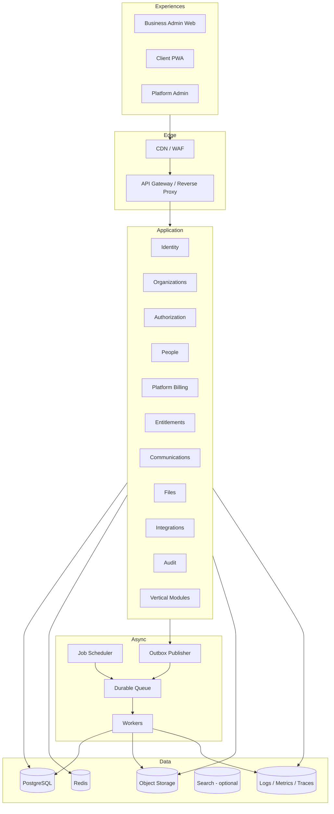
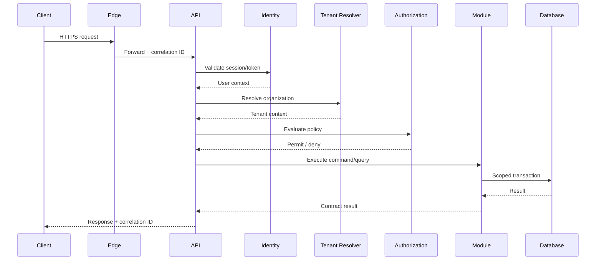

# System Architecture Document (SAD)

> **Status:** Baseline architecture specification  
> **Audience:** Product, Architecture, Engineering, QA, Security, DevOps, Design, AI coding agents  
> **Scope rule:** The Platform Core remains industry-neutral. Studio-, coaching-, running-, clinic- and treatment-specific rules belong to vertical modules unless explicitly classified as shared business capabilities.  
> **Decision policy:** Statements marked **Decision** are normative. Statements marked **Open Decision** require an ADR before implementation.

## 1. Architecture Style

**Decision:** Modular monolith for synchronous business capabilities; event-driven asynchronous workers for external integrations, notifications, file processing, scheduled work and reconciliation.

Reasons:

- Strong transactional consistency inside bounded modules.
- Lower initial operational complexity than microservices.
- Explicit module boundaries.
- Easy local development and end-to-end testing.
- Clear path to later extraction.

## 2. Logical Architecture

## 3. Runtime Components

| Component | Responsibility | Scaling |
|---|---|---|
| Web applications | Role-aware user experiences. | CDN/static hosting, horizontal. |
| Application API | Synchronous commands and queries. | Stateless horizontal scaling. |
| Worker service | Asynchronous consumers. | Scale per queue and workload. |
| Scheduler | Creates durable jobs; never performs business work directly. | Active-passive or managed scheduler. |
| PostgreSQL | Transactional system of record. | Managed HA, read replicas later. |
| Redis | Cache, distributed coordination, rate limits, ephemeral state. | Managed HA. |
| Object storage | Files, exports and media. | Managed virtually unlimited. |
| Observability platform | Logs, metrics, traces and alerting. | Managed. |

## 4. Module Rules

- Each module owns its domain and persistence mapping.
- Direct cross-module table access is prohibited.
- Synchronous cross-module calls use explicit application interfaces.
- Asynchronous cross-module communication uses versioned events.
- Shared utility code may not contain domain behavior.
- A module may expose read models but not internal entities.
- Cross-module transactions require an explicit orchestration decision.
- External provider state is normalized into internal domain state.

## 5. Request Lifecycle

## 6. Deployment Topology

Environments:

- Local.
- Shared development.
- Integration.
- Staging.
- Production.
- Optional ephemeral preview environments.

Production must isolate network boundaries, secrets, databases, queues, object storage, identity configuration, provider credentials and observability datasets.

## 7. Technology Direction

The architecture is implementation-language neutral. Recommended baseline:

- Backend: current LTS managed runtime with strong type safety and production ecosystem.
- Frontend: TypeScript + component-based framework.
- Database: PostgreSQL.
- Cache/coordination: Redis.
- Messaging: managed durable queue/event bus.
- Files: S3-compatible object storage.
- Infrastructure: infrastructure as code.
- Contracts: OpenAPI for HTTP, AsyncAPI-style catalog for events.

## 8. Availability and Failure Domains

- API instances are stateless.
- Worker failures must not block synchronous API availability.
- Provider outages are isolated through queues, retries and circuit breakers.
- Object storage failure must not corrupt transactional metadata.
- Cache failure degrades performance, not correctness.
- Event publication uses transactional outbox.
- Dead-letter queues require operational workflows.

## 9. Extraction Criteria

A module may become a service when one or more are true:

- Independent scaling is materially required.
- Distinct security boundary is required.
- Separate team owns lifecycle.
- Provider/runtime requirements differ.
- Failure isolation justifies distributed complexity.
- Data volume or latency cannot be served by the monolith.
