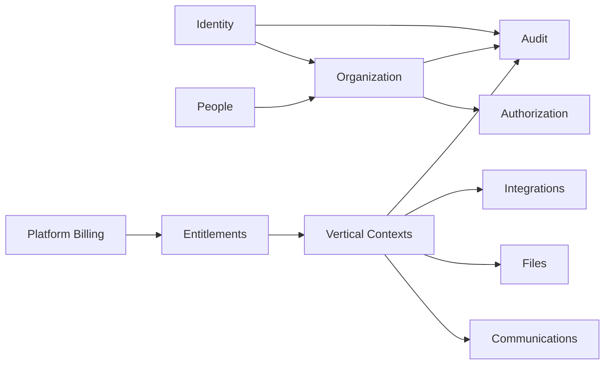

# Domain-Driven Design

> **Status:** Baseline architecture specification  
> **Audience:** Product, Architecture, Engineering, QA, Security, DevOps, Design, AI coding agents  
> **Scope rule:** The Platform Core remains industry-neutral. Studio-, coaching-, running-, clinic- and treatment-specific rules belong to vertical modules unless explicitly classified as shared business capabilities.  
> **Decision policy:** Statements marked **Decision** are normative. Statements marked **Open Decision** require an ADR before implementation.


## 1. DDD Approach

Tempo applies strategic and tactical DDD to protect module boundaries. The goal is not to maximize patterns; it is to model business invariants explicitly and prevent vertical rules from leaking into the Platform Core.

## 2. Bounded Contexts



## 3. Tactical Building Blocks

| Building block | Rule |
|---|---|
| Aggregate | Transactional consistency boundary. |
| Entity | Identity and lifecycle. |
| Value Object | Immutable validated concept. |
| Domain Service | Domain behavior not naturally owned by one entity. |
| Repository | Aggregate persistence contract only. |
| Domain Event | Fact produced inside a transaction. |
| Integration Event | Versioned fact published to other modules/systems. |
| Application Service | Orchestrates use case, transaction and policies. |
| Specification / Policy | Reusable business or authorization rule. |

## 4. Aggregate Guidance

- Keep aggregates small.
- Never load an organization with every member.
- Reference other aggregates by identifier.
- Enforce invariants inside aggregate methods.
- Do not expose public setters.
- Persist one aggregate per transaction unless an application orchestration explicitly requires otherwise.
- Use optimistic concurrency for mutable aggregates.
- Use database constraints as a second line of defense.

## 5. Core Aggregate Candidates

### Identity

- `UserAccount`
- `Session`
- `Invitation`

### Organization

- `Organization`
- `OrganizationMembership`
- `OrganizationBrand`

### Authorization

- `RoleDefinition`
- `RoleAssignment`

### People

- `Person`
- `OrganizationPerson`
- `Consent`
- `PersonRelationship`

### Billing

- `PlatformSubscription`
- `PlanVersion`
- `BillingAccount`

### Entitlements

- `EntitlementGrant`
- `UsageBucket`

### Communications

- `NotificationTemplate`
- `NotificationRequest`
- `DeliveryAttempt`
- `CommunicationPreference`

### Integrations

- `IntegrationConnection`
- `WebhookInboxItem`
- `ExternalReference`

## 6. Example Aggregate

```csharp
public sealed class OrganizationMembership
{
    public MembershipId Id { get; }
    public OrganizationId OrganizationId { get; }
    public UserId UserId { get; }
    public MembershipStatus Status { get; private set; }
    private readonly List<RoleAssignment> _roles = [];

    public void Activate(VerifiedInvitation invitation)
    {
        if (Status != MembershipStatus.Invited)
            throw new DomainRuleViolation("membership.invalid_state");

        if (invitation.UserId != UserId || invitation.OrganizationId != OrganizationId)
            throw new DomainRuleViolation("membership.invitation_mismatch");

        Status = MembershipStatus.Active;
        Raise(new MembershipActivated(Id, OrganizationId, UserId));
    }
}
```

## 7. Ubiquitous Language

| Term | Definition |
|---|---|
| Tenant | Runtime isolation context represented by an organization or approved organization scope. |
| Organization | Business entity using Tempo. |
| Membership | User's relationship to an organization. |
| Person | Real-world individual. |
| User Account | Authentication identity. |
| Organization Person | Person's non-login business relationship to an organization. |
| Platform Subscription | Organization's SaaS subscription to Tempo. |
| Entitlement | Granted capability or limit. |
| Vertical | Product-specific bounded context. |

## 8. Domain Event Lifecycle

1. Aggregate raises domain event.
2. Application service saves aggregate and outbox item in one transaction.
3. Outbox publisher publishes integration event.
4. Consumers process idempotently.
5. Failures retry and eventually enter dead-letter workflow.
6. Reconciliation detects missing or conflicting state.

## 9. Anti-Corruption Layers

External provider objects must never become core entities.

```text
Provider Request/Response
        ↕
Provider Adapter
        ↕
Normalized Internal Contract
        ↕
Domain/Application Service
```

## 10. Naming Rules

- Domain names express business meaning, not database implementation.
- Avoid `Manager`, `Helper`, `CommonService`, `GenericEntity`.
- Commands are imperative: `InviteOrganizationMember`.
- Events are past tense: `OrganizationMemberInvited`.
- Queries describe result: `GetOrganizationMemberDetails`.
- Permission keys use stable lowercase dot notation.
