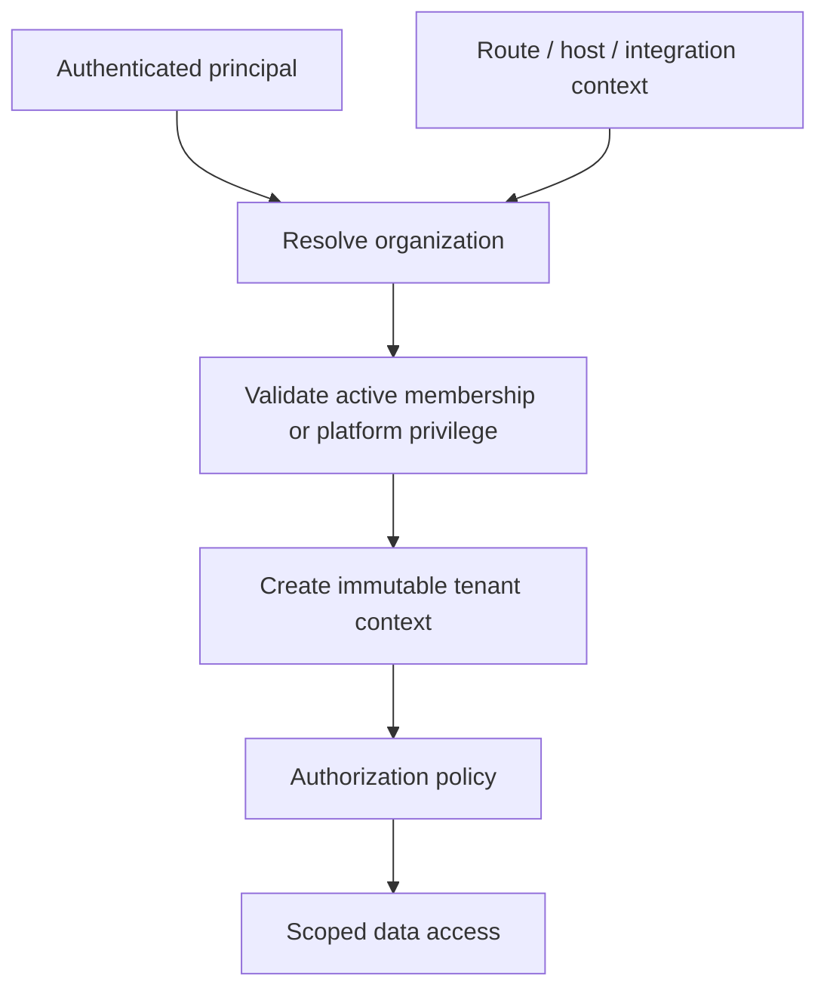

# Multi-Tenant Architecture

> **Status:** Baseline architecture specification  
> **Audience:** Product, Architecture, Engineering, QA, Security, DevOps, Design, AI coding agents  
> **Scope rule:** The Platform Core remains industry-neutral. Studio-, coaching-, running-, clinic- and treatment-specific rules belong to vertical modules unless explicitly classified as shared business capabilities.  
> **Decision policy:** Statements marked **Decision** are normative. Statements marked **Open Decision** require an ADR before implementation.


## 1. Tenancy Decision

**Decision:** Shared application and shared PostgreSQL schema with immutable `organization_id` on tenant-owned records. Tenant isolation is enforced at multiple layers.

## 2. Tenant Concepts

- `Organization` is the primary business tenant.
- A future organization group may aggregate multiple organizations.
- Locations are not separate tenants unless legal/data isolation requirements demand it.
- A user may belong to multiple organizations.
- Platform operators do not become organization members merely to support a tenant.

## 3. Tenant Resolution

Accepted resolution methods:

1. Explicit route: `/organizations/{organizationId}/...`
2. Organization slug/subdomain for client experiences.
3. Selected organization stored in session only as a convenience; server validates every request.
4. Signed system-to-system context for approved integrations.



## 4. Tenant Context

```json
{
  "organizationId": "uuid",
  "userId": "uuid|null",
  "membershipId": "uuid|null",
  "platformActorId": "uuid|null",
  "correlationId": "string",
  "impersonationSessionId": "uuid|null"
}
```

Rules:

- Tenant context is immutable per request.
- Tenant-scoped repositories require it explicitly.
- Background jobs carry tenant context.
- Events include tenant identifier.
- Missing context fails closed.

## 5. Database Enforcement

Every tenant-owned table includes `organization_id`, timestamps and concurrency version.

```sql
ALTER TABLE people.organization_people ENABLE ROW LEVEL SECURITY;

CREATE POLICY tenant_isolation_organization_people
ON people.organization_people
USING (organization_id = current_setting('app.organization_id')::uuid)
WITH CHECK (organization_id = current_setting('app.organization_id')::uuid);
```

Additional controls:

- foreign keys.
- composite unique constraints.
- tenant-leading indexes.
- application DB role cannot bypass RLS.
- separate controlled admin connection.
- automated repository isolation tests.

## 6. Caching

Cache keys include tenant scope:

```text
tenant:{organizationId}:membership:{membershipId}
tenant:{organizationId}:entitlements:v{version}
tenant:{organizationId}:brand
```

## 7. Search and Analytics

- Search indexes include tenant identifier.
- Exports are tenant-scoped jobs.
- Cross-tenant analytics use governed pipelines.
- Platform analytics should default to aggregates rather than raw records.

## 8. Tenant Lifecycle

```text
Provisioning → Trialing → Active → PastDue → Restricted → Suspended → Closed → Purged
```

Each state defines reads, writes, authentication, retention, export and reactivation.

## 9. Impersonation

- platform permission and MFA.
- reason/support ticket.
- short-lived restricted session.
- dual actor audit.
- prohibited destructive and billing-security operations.
- visible UI banner.

## 10. Mandatory Isolation Tests

- tenant A cannot read/write tenant B.
- ID enumeration fails.
- job tenant mismatch fails.
- cache and search isolation.
- export isolation.
- platform bypass requires explicit privilege.
