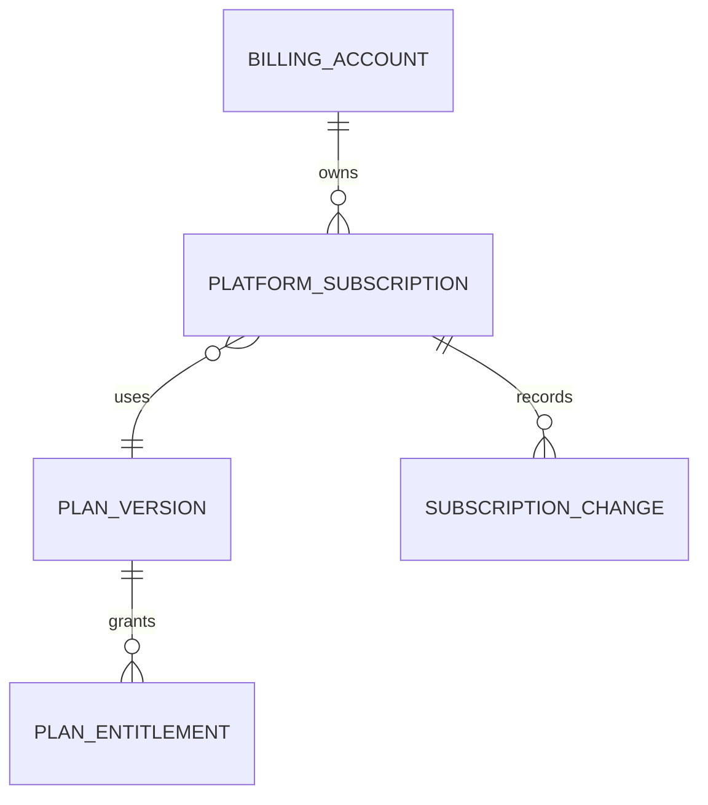

# Platform Billing Architecture

> **Status:** Baseline architecture specification  
> **Audience:** Product, Architecture, Engineering, QA, Security, DevOps, Design, AI coding agents  
> **Scope rule:** The Platform Core remains industry-neutral. Studio-, coaching-, running-, clinic- and treatment-specific rules belong to vertical modules unless explicitly classified as shared business capabilities.  
> **Decision policy:** Statements marked **Decision** are normative. Statements marked **Open Decision** require an ADR before implementation.


## 1. Scope

Tempo charging organizations for SaaS access. Merchant/client payments are separate.

## 2. Model



Entities:

- BillingAccount.
- PlatformSubscription.
- Product.
- Plan.
- PlanVersion.
- Price.
- Trial.
- AddOn.
- SubscriptionChange.
- BillingProviderReference.

## 3. Subscription States

```text
Draft → Trialing → Active → PastDue → GracePeriod → Restricted → Canceled
```

State defines access, dunning, notifications, retention and reactivation.

## 4. Provider Flow

Signed webhook → durable inbox → queue → idempotent normalization → subscription state → entitlement recalculation.

## 5. Entitlements

Billing events trigger versioned entitlement snapshot updates. Product code asks the entitlement service, never the plan name.

## 6. Reconciliation

Scheduled job compares provider and internal state, reports mismatch and applies safe corrections.

## 7. Security

No raw card data. Hosted/tokenized flows. Separate billing permissions. Audit manual changes and protect webhook secrets.
