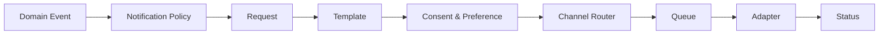

# Notification System

> **Status:** Baseline architecture specification  
> **Audience:** Product, Architecture, Engineering, QA, Security, DevOps, Design, AI coding agents  
> **Scope rule:** The Platform Core remains industry-neutral. Studio-, coaching-, running-, clinic- and treatment-specific rules belong to vertical modules unless explicitly classified as shared business capabilities.  
> **Decision policy:** Statements marked **Decision** are normative. Statements marked **Open Decision** require an ADR before implementation.


## 1. Purpose

Reliable, consent-aware delivery through email, SMS, push, WhatsApp and in-app channels.

## 2. Flow



## 3. Template Rules

Versioned, localized, typed variables, tenant branding, validated preview and no executable content.

## 4. Channel Selection

Uses purpose, policy, recipient preference, consent, urgency, provider health and cost. Fallback requires compatible consent.

## 5. Delivery State

```text
Queued → Sending → Accepted → Delivered
                  ↘ Failed → RetryScheduled → DeadLettered
```

## 6. Deduplication

```text
{organizationId}:{notificationType}:{subjectId}:{recipientId}:{occurrence}
```

## 7. Webhooks

Verify, persist inbox, map reference, update idempotently and immediately enforce complaint/opt-out.

## 8. Metrics

Queue latency, delivery, bounce, retry, cost, suppression and provider health.
